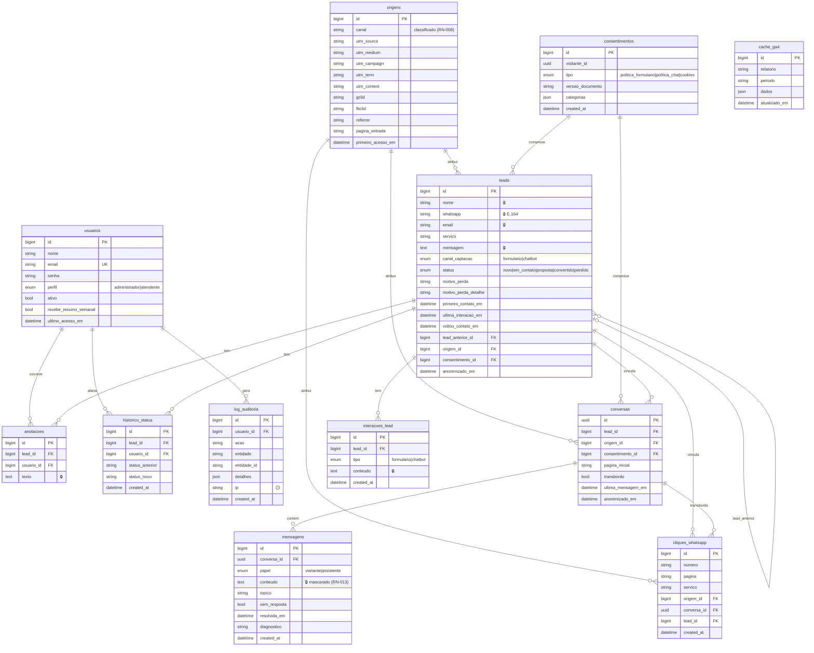

# 06 — Modelo de dados

Convenção: tabelas, colunas e variáveis em **português**, em `snake_case` e sem acentos (ex.: `historico_status`, `primeiro_contato_em`). As tabelas técnicas do framework (`jobs`, `failed_jobs`, `cache`, `sessions`, `password_reset_tokens`, `migrations`) mantêm o nome padrão do Laravel. Todas as datas são gravadas em UTC e exibidas em America/Sao_Paulo (RN-020).

Legenda LGPD: 🔒 dado pessoal (anonimizado em RN-012 e RF-030) · 🕒 dado com retenção curta.

## Diagrama

## Entidades

| Tabela | Finalidade | RF / RN |
| --- | --- | --- |
| `usuarios` | Usuários da área restrita (administrador e atendente) | RF-018, RF-019, RN-017, RN-018, RN-019 |
| `leads` | Contato captado pelo formulário ou pelo chatbot | RF-006, RF-015, RF-023 a RF-026, RN-001 a RN-007 |
| `origens` | Primeiro toque (UTM, gclid, fbclid, referrer, página de entrada) e canal classificado | RF-008, RF-021, RN-008, RN-009 |
| `consentimentos` | Evidência de cada aceite (política no formulário ou no chat, cookies), com a versão do documento | RF-006, RF-009, RF-013, RN-011, RNF-025 |
| `interacoes_lead` | Contatos repetidos do mesmo lead (RN-003) e o conteúdo original de cada envio | RF-024, RN-003 |
| `historico_status` | Toda mudança de status, com autor e data | RF-024, RF-025, RN-004, RN-005 |
| `anotacoes` | Anotações da equipe na ficha | RF-024 |
| `conversas` | Sessão de chat (o `id` é o UUID que o widget usa), vinculada ao lead quando houver | RF-013 a RF-017, RF-028 |
| `mensagens` | Cada mensagem do visitante e do assistente; `sem_resposta` e `topico` alimentam os insights | RF-017, RF-028, RN-013 |
| `cliques_whatsapp` | Cliques nos botões de WhatsApp e transbordos, com a origem | RF-005, RF-016, RF-020, RN-010 |
| `log_auditoria` | Ações sensíveis: exportação, anonimização, gestão de usuários, login | RF-026, RF-030, RNF-009 |
| `cache_ga4` | Relatórios do GA4 em cache, atualizados de hora em hora pelo agendador | RF-022 |

## Detalhes e decisões

- **Status e motivo de perda:** valores fixos em enums do PHP (`StatusLead`, `MotivoPerda`), não em tabela. A taxa de conversão (RN-007) é calculada sobre `leads`, por `created_at`.
- **Serviço de interesse:** lista fixa em configuração (os 8 serviços, "parceria" e "outro"). Como os serviços ficam no código no MVP, não há tabela `servicos`.
- **Origem:** a mesma linha de `origens` pode ser compartilhada pelo lead, pela conversa e pelos cliques da mesma visita. Ela só é gravada quando o visitante vira lead, conversa no chat ou clica no WhatsApp (RN-009).
- **Consentimento de cookies:** a preferência fica num cookie necessário no navegador, com a versão e a data. No servidor grava-se um registro em `consentimentos` com um `visitante_id` aleatório, sem IP, como evidência (RN-011).
- **IP:** não é gravado em leads, conversas nem consentimentos. O limite anti-abuso (RN-016) usa o cache do Laravel, que expira. Em `log_auditoria`, o IP dos usuários internos é apagado depois de 30 dias (RNF-023).
- **Anonimização (RN-012, RF-030):** em `leads`, apaga `nome`, `whatsapp`, `email`, `mensagem` e preenche `anonimizado_em`. Apaga `interacoes_lead.conteudo`, `anotacoes`, `mensagens` e as conversas vinculadas. Ficam `servico`, `canal_captacao`, `status`, `motivo_perda`, as datas e a origem, para os relatórios.
- **Deduplicação (RN-003):** índices em `leads.whatsapp` e `leads.email` para a busca de lead aberto nos últimos 30 dias.
- **Índices de relatório:** `leads(created_at, status)`, `leads(origem_id)`, `cliques_whatsapp(created_at)`, `mensagens(sem_resposta, resolvida_em)`.
- **Fora do banco do site:** a base de conhecimento do chatbot (Qdrant) e o banco interno do n8n ficam no ambiente Docker do n8n.

## Dados pessoais (LGPD)

| Dado | Onde | Finalidade | Base legal | Retenção |
| --- | --- | --- | --- | --- |
| Nome, WhatsApp, e-mail, mensagem | `leads`, `interacoes_lead` | Retorno comercial ao interessado | Consentimento (e procedimentos preliminares a contrato) | 24 meses após a última interação |
| Conversa do chat | `mensagens` (mascarada) | Atendimento e melhoria do assistente | Consentimento | 24 meses |
| Anotações da equipe | `anotacoes` | Acompanhamento comercial | Legítimo interesse | Junto com o lead |
| Origem da visita | `origens` | Medir canais de captação | Consentimento (cookies) ou legítimo interesse, limitado à sessão | Junto com o lead; agregada depois |
| Dados dos usuários internos | `usuarios`, `log_auditoria` | Acesso e segurança | Legítimo interesse | Enquanto ativo; auditoria por 24 meses; IP por 30 dias |

## Histórico de alterações

| Data | ID | Mudança | Origem |
| --- | --- | --- | --- |
| 2026-11-06 | — | Criação do documento | /iniciar-projeto |
