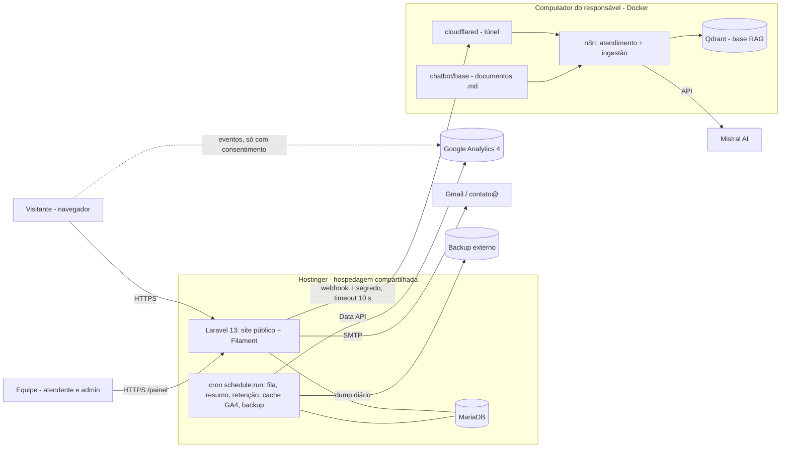

# 07 — Stack e arquitetura

Versões estáveis conferidas em 2026-11-06 (Packagist e GitHub Releases).

## Stack

| Camada | Escolha | Versão | Motivo |
| --- | --- | --- | --- |
| Linguagem | PHP | **8.5** (local, Docker e produção) | Disponível no plano Business da Hostinger (7.3 a 8.5, conferido em 2026-11-06); atende o mínimo 8.4 de Pest 5 e spatie/laravel-analytics |
| Framework | Laravel | **13.x** (13.40) | Domínio do responsável; roda em hospedagem compartilhada; suporte de segurança até 2028 |
| Área restrita | Filament + Livewire | **5.x** (5.11) + Livewire **4.x** | Tabelas, filtros, formulários, widgets de gráfico e gestão de usuários prontos, o que é decisivo para 1 mês com 1 pessoa ([ADR-002](adr/ADR-002-filament-area-restrita.md)) |
| Kanban | relaticle/flowforge | **4.x** (4.3) | Kanban nativo para Filament 5 (RF-025) |
| Site público | Blade + Tailwind CSS + Alpine.js, build com Vite | Tailwind **4.x** (4.3) | HTML leve e rápido (RNF-011), sem framework SPA; assets compilados no CI ([ADR-003](adr/ADR-003-site-publico-blade-tailwind.md)) |
| Banco | MariaDB (MySQL compatível) | Mesma versão da Hostinger, confirmada na `/configurar-infra` | Oferecido pela hospedagem compartilhada; Docker local com a mesma versão |
| Filas e agendamentos | Driver `database` + cron a cada minuto (`schedule:run`, com `queue:work --stop-when-empty`) | — | Sem processos persistentes ([ADR-004](adr/ADR-004-fila-database-cron.md)) |
| E-mail | SMTP (Gmail na demonstração) | — | Configurável por `.env` (RNF-031) |
| Google Analytics | GA4 + Consent Mode v2; painel via spatie/laravel-analytics (Google Analytics Data API) | spatie **5.x** (5.8) | RF-010, RF-022 |
| Chatbot | n8n + Mistral (chat e `mistral-embed`) + Qdrant | n8n **2.x** (2.46), Qdrant **1.20** | [ADR-005](adr/ADR-005-chatbot-n8n-rag.md) |
| Túnel (demonstração) | Cloudflare Tunnel (`cloudflared`, URL trycloudflare) | 2026.10 | Expõe o n8n local com HTTPS, de graça |
| Testes | Pest (unitário, feature e browser com Playwright) | **5.x** (5.3) | RNF-032; E2E dos fluxos críticos |
| Qualidade | Laravel Pint, Larastan | Larastan **3.x** (3.14) | Lint e análise estática no CI |
| Ambiente local | Docker Compose: app PHP, MariaDB, Mailpit, n8n, Qdrant, cloudflared | — | Mesmo banco de produção; n8n e Qdrant junto |

## Arquitetura

Monólito Laravel com duas faces (site público e área restrita `/painel`) na hospedagem compartilhada. O chatbot fica num serviço separado (n8n), alcançado só pelo servidor.

### Módulos do Laravel

- **Site:** páginas Blade, formulário (Form Request + Action), botões de WhatsApp, banner de cookies, atribuição de origem (middleware que guarda o primeiro toque), SEO.
- **Leads:** domínio de leads (deduplicação RN-003, status RN-004 a RN-006, notificação RF-007), com as regras em classes testáveis (Actions e Enums), não em controllers.
- **Chat:** endpoint `POST /chat/mensagens` (limite de requisições), cliente HTTP do n8n com timeout e fallback, mascaramento de dados sensíveis (RN-013), gravação de conversas e mensagens.
- **Painel (Filament):** dashboard (widgets), origem e estratégia, leads (resource), kanban (Flowforge), ficha, usuários, insights do chat, auditoria.
- **Tarefas agendadas:** fila, resumo semanal (segunda às 8h), retenção (diária), cache do GA4 (de hora em hora), backup (diário), limpeza de IPs (diária).

### Deploy (detalhado na `/configurar-cd`)

Plano já contratado: **Hostinger Business** (conta `u828679584`), que já hospeda outros projetos Laravel do responsável. Funções desativadas no PHP web (`exec`, `proc_open`, `symlink`...) não afetam a aplicação; o PHP de linha de comando usado pelo cron é conferido na `/configurar-infra`.

O GitHub Actions compila os assets e instala as dependências sem as de desenvolvimento. Depois envia uma release por SSH para `releases/<data>`, troca o link simbólico `current` (deploy atômico, RNF-002) e roda `migrate --force`. A pasta pública do domínio aponta para `current/public`.

## Alternativas consideradas

| Alternativa | Por que não |
| --- | --- |
| WordPress | Painel de leads, kanban, atribuição e chatbot exigiriam vários plugins e código sob medida; o responsável domina Laravel |
| Next.js / Node | A hospedagem compartilhada não roda Node de forma estável e o orçamento é baixo |
| Painel feito à mão em Livewire/Blade | Mais trabalho que o Filament para tabelas, filtros e gráficos, sem ganho para o MVP |
| Inertia + Vue/React no site | Mais peso de JavaScript, pior para Core Web Vitals; o site é conteúdo |
| Base do chatbot como manual no prompt (como o bot anterior) | Escolha do responsável por RAG com Qdrant para comportar os materiais do C6 ([ADR-005](adr/ADR-005-chatbot-n8n-rag.md)) |
| Redis para fila e cache | Não disponível na hospedagem compartilhada |

## ADRs

- [ADR-001 — Monólito Laravel 13 em hospedagem compartilhada](adr/ADR-001-laravel-hospedagem-compartilhada.md)
- [ADR-002 — Filament 5 na área restrita](adr/ADR-002-filament-area-restrita.md)
- [ADR-003 — Site público em Blade, Tailwind e Alpine](adr/ADR-003-site-publico-blade-tailwind.md)
- [ADR-004 — Fila no banco e tarefas por cron](adr/ADR-004-fila-database-cron.md)
- [ADR-005 — Chatbot em n8n com Mistral e RAG no Qdrant, via proxy Laravel](adr/ADR-005-chatbot-n8n-rag.md)
- [ADR-006 — Consentimento de cookies e atribuição de origem própria](adr/ADR-006-consentimento-e-atribuicao.md)
- [ADR-007 — Nomes do código em português](adr/ADR-007-codigo-em-portugues.md)

## Histórico de alterações

| Data | ID | Mudança | Origem |
| --- | --- | --- | --- |
| 2026-11-06 | ADR-001 a ADR-007 | Criação do documento | /iniciar-projeto |
