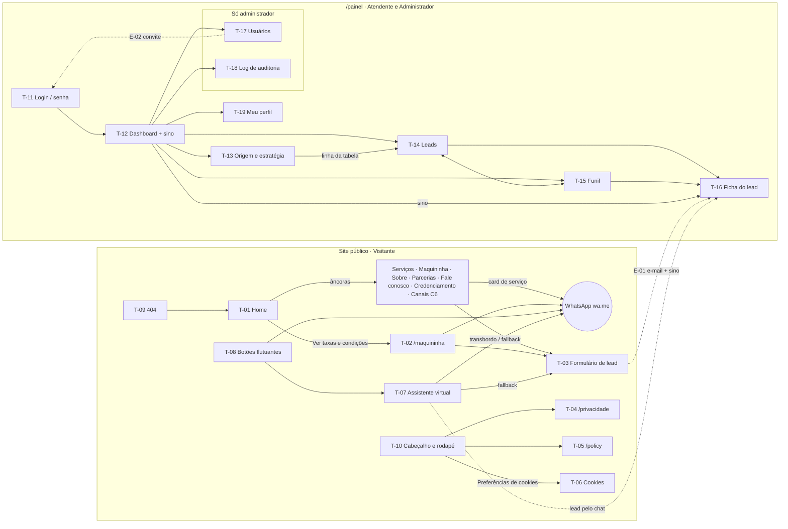

# 10 — UX: navegação, telas e decisões

Wireframes de baixa fidelidade em [ux/wireframes/](ux/wireframes/index.html) (abrir o `index.html` no navegador). Visual e componentes em [ux/design-system.md](ux/design-system.md). Lista original das telas em [09-plano-prototipo.md](09-plano-prototipo.md).

## Mapa de navegação

## Inventário de telas

| Tela | Objetivo | Perfis | RF | Wireframe |
| --- | --- | --- | --- | --- |
| T-01 Home | Apresentar a B2BSAFE e levar ao contato (cards de serviço → WhatsApp; seção própria da Maquininha) | Visitante | RF-001, RF-005, RF-006 | [t01-home](ux/wireframes/t01-home.html) |
| T-02 Maquininha | Vantagens, **tabela de taxas**, adquirentes e pedido da C6 Pay | Visitante | RF-002, RF-005, RF-006 | [t02-maquininha](ux/wireframes/t02-maquininha.html) |
| T-03 Formulário de lead | Captar o lead; estados de preenchimento, erro, envio, sucesso e falha | Visitante | RF-006, RF-008 | [t03-formulario](ux/wireframes/t03-formulario.html) |
| T-04 Política de Privacidade | Transparência LGPD do site, do chat e dos cookies | Visitante | RF-003 | [t04-privacidade](ux/wireframes/t04-privacidade.html) |
| T-05 /policy | Termos do B2BSafe Connect (Meta), com a numeração corrigida | Visitante | RF-004 | [t05-policy](ux/wireframes/t05-policy.html) |
| T-06 Cookies | Faixa no rodapé + diálogo de preferências | Visitante | RF-009, RF-010 | [t06-cookies](ux/wireframes/t06-cookies.html) |
| T-07 Assistente virtual | Aviso de IA, sugestões, conversa, captação, transbordo, fallback, limite, celular | Visitante | RF-013 a RF-017 | [t07-chat](ux/wireframes/t07-chat.html) |
| T-08 Botões flutuantes | WhatsApp e chat empilhados; mensagens por contexto | Visitante | RF-005 | [t08-whatsapp](ux/wireframes/t08-whatsapp.html) |
| T-09 404 | Recuperar o visitante perdido | Visitante | RF-012 | [t09-404](ux/wireframes/t09-404.html) |
| T-10 Cabeçalho e rodapé | Navegação, menu móvel, dados legais, aviso de parceiro | Visitante | RF-001, RF-009 | [t10-layout](ux/wireframes/t10-layout.html) |
| T-11 Login e senha | Entrar, erros, recuperar, definir senha, link expirado | Atendente, Admin | RF-018, RF-019 | [t11-login](ux/wireframes/t11-login.html) |
| T-12 Dashboard | KPIs, canais, serviços, leads por dia, últimos leads; **sino de notificações** | Atendente, Admin | RF-020, RF-031 | [t12-dashboard](ux/wireframes/t12-dashboard.html) |
| T-13 Origem e estratégia | Leads e conversão por canal, campanha e serviço | Atendente, Admin | RF-021 (RF-022 reservado) | [t13-origem](ux/wireframes/t13-origem.html) |
| T-14 Lista de leads | Busca, filtros na URL, exportação CSV | Atendente, Admin | RF-023, RF-026 | [t14-leads](ux/wireframes/t14-leads.html) |
| T-15 Funil | Kanban com motivo de perda e alternativa ao arrastar | Atendente, Admin | RF-025 | [t15-kanban](ux/wireframes/t15-kanban.html) |
| T-16 Ficha do lead | Duas colunas: dados/origem/consentimentos e linha do tempo; LGPD | Atendente, Admin (LGPD só admin) | RF-024, RF-030 | [t16-ficha-lead](ux/wireframes/t16-ficha-lead.html) |
| T-17 Usuários | Convidar, editar, desativar, reativar; último admin protegido | Admin | RF-019 | [t17-usuarios](ux/wireframes/t17-usuarios.html) |
| T-18 Log de auditoria | Consultar ações sensíveis | Admin | RF-030 | [t18-auditoria](ux/wireframes/t18-auditoria.html) |
| T-19 Meu perfil | Nome, senha, aparência | Atendente, Admin | RF-018 | [t19-perfil](ux/wireframes/t19-perfil.html) |
| E-01 Novo lead | E-mail de lead novo e de "voltou a entrar em contato" | Sistema → equipe | RF-007 | [e01](ux/wireframes/e01-email-novo-lead.html) |
| E-02 Convite / senha | Convite de usuário e redefinição de senha | Sistema → usuário | RF-018, RF-019 | [e02](ux/wireframes/e02-email-convite.html) |

## Decisões de UX

| # | Decisão | Motivo / origem |
| --- | --- | --- |
| UX-01 | Cores do logo da B2BSAFE: fundo branco e cinza gelo `#F4F5F7`, segunda cor preto `#060606`, terceira cor amarelo `#FFCC29` (destaque, nunca texto sobre fundo claro) | Responsável (substitui a proposta azul-petróleo); RN-015 cobre a semelhança com o C6 |
| UX-02 | Visual corporativo e sóbrio | Usuário |
| UX-03 | Botões de WhatsApp e chat **empilhados** no canto direito; no celular só ícones; somem com o chat em tela cheia | Usuário; RF-013 |
| UX-04 | Painel no tema padrão do Filament, só com a cor, o logo e a fonte da marca | Usuário; prazo |
| UX-05 | Cards de serviço: "Fale com um atendente" no hover/foco (sempre visível no celular); clique abre o WhatsApp com o serviço | Usuário → **RF-001 alterado** |
| UX-06 | Maquininha vira **seção própria na Home** (imagem + chamada para o WhatsApp 92460-0991), com link "Ver taxas e condições" para `/maquininha` | Usuário |
| UX-07 | `/maquininha` mostra **tabela de taxas** "a partir de", em configuração, com a data de referência e o aviso de análise do C6 | Usuário → **RF-002 alterado** |
| UX-08 | Formulário: sucesso substitui o formulário, sem recarregar e **sem prometer prazo**; oferece seguir pelo WhatsApp | Usuário |
| UX-09 | Duplicado (RN-003) recebe a mesma confirmação do lead novo: o visitante não percebe a diferença | Privacidade e simplicidade |
| UX-10 | Banner de cookies em **faixa no rodapé**, não modal; "Recusar" com o mesmo peso de "Aceitar" | Usuário; RF-009 |
| UX-11 | O chat capta nome e WhatsApp **na conversa** (o n8n extrai), e o selo "Contato registrado" só aparece depois de gravado | Usuário; RF-015 |
| UX-12 | Depois do "Concordo", o chat mostra **4 sugestões** de pergunta em botões | Usuário |
| UX-13 | Chat em tela cheia abaixo de 640 px | Usabilidade no celular |
| UX-14 | Ficha do lead em **duas colunas**, com linha do tempo única e filtrável (tudo, anotações, conversa, status) | Usuário |
| UX-15 | Card do kanban: nome, serviço, etiqueta do canal e botão de WhatsApp; menu ⋯ "Mover para…" como alternativa ao arrastar | Usuário; RF-025 (WCAG 2.5.7) |
| UX-16 | **Sino de notificações** de novo lead no painel, atualizado a cada 30 s | Usuário → **RF-031 novo** |
| UX-17 | Anonimizar exige digitar "ANONIMIZAR"; a ficha anonimizada fica só leitura | RF-030 |
| UX-18 | Usuários nunca são excluídos, só desativados | Preserva autoria e auditoria |
| UX-19 | Fontes hospedadas no próprio site (sem Google Fonts) | LGPD: nada a terceiros antes do consentimento |
| UX-20 | **Sem emojis**: ícones só da biblioteca Lucide (marcas com o SVG oficial) | Responsável — regra fundamental |
| UX-21 | **Sem eyebrows** acima de títulos | Responsável — regra fundamental |
| UX-22 | **Sem bordas de um lado só** (destaque por borda completa, fundo, peso ou ícone) | Responsável — regra fundamental |
| UX-23 | O visual final será refinado com referências de outros sites antes de implementar a interface | Responsável |
| UX-24 | **Tipografia: Urbanist** em todo o site, painel e e-mails, para títulos e texto; hospedada no próprio site. Sem algarismos tabulares: valores alinhados à direita | Escolha do responsável entre 42 opções ([ux/tipografia.html](ux/tipografia.html)) |

### Propostas incluídas nos wireframes (confirmar na revisão)

Pequenos detalhes que não estavam nos requisitos. Se não forem aprovados, saem sem impacto:

- **T-13 "Leitura rápida":** frase gerada por regra simples (sem IA) destacando o canal de maior volume e de maior conversão.
- **T-15:** toast com "Desfazer" por 5 s depois de mover um card (exceto para Perdido); colunas Convertido e Perdido mostram só os últimos 30 dias.
- **T-07:** balão "Posso ajudar?" uma vez, 8 s depois da primeira visita.
- **T-14:** exportação acima de ~5 mil linhas vai para a fila, com o link por e-mail (na demonstração não acontece).

## Comportamento em celular (resumo)

- Site: menu em painel de tela cheia; cards e seções em uma coluna; formulário com botão de largura total; botões flutuantes só com ícones.
- Painel: menu lateral recolhido; tabelas do Filament viram cartões empilhados; tabela de origem rola na horizontal; kanban mostra uma coluna por vez, com abas; ficha empilhada, com "Chamar no WhatsApp" fixo no pé.

## Histórico de alterações

| Data | ID | Mudança | Origem |
| --- | --- | --- | --- |
| 2026-11-07 | UX-01 a UX-19 | Criação do documento | /desenhar-telas |
| 2026-11-07 | UX-24 | Tipografia definida: Urbanist | Escolha do responsável |
| 2026-11-07 | UX-01 | Paleta trocada para a do logo (branco/gelo, preto, amarelo) | Pedido do responsável |
| 2026-11-07 | UX-20 a UX-23 | Regras fundamentais de interface e refinamento por referências | Pedido do responsável |
